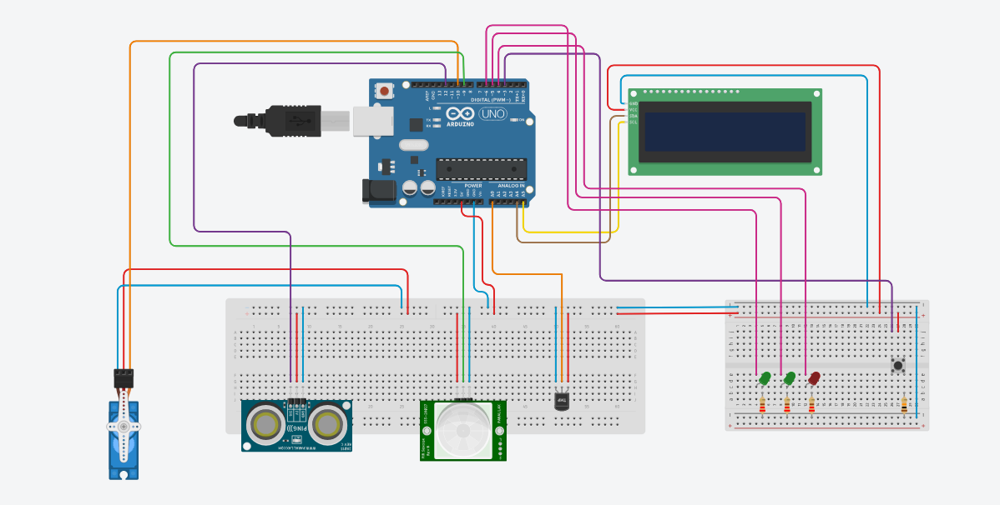
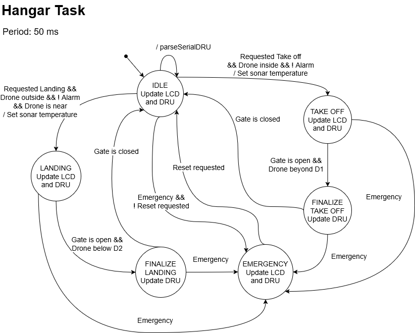
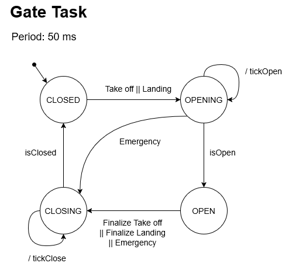
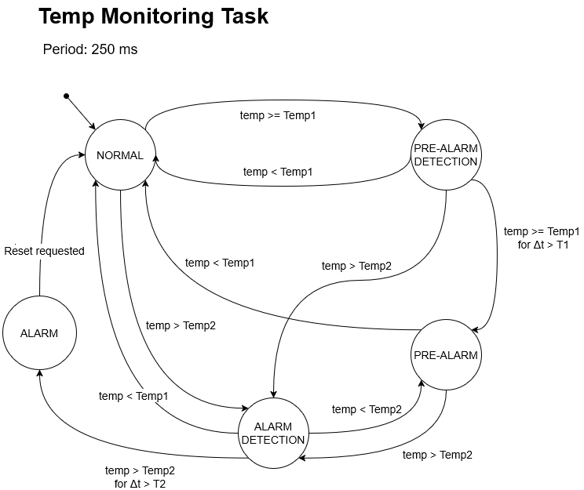
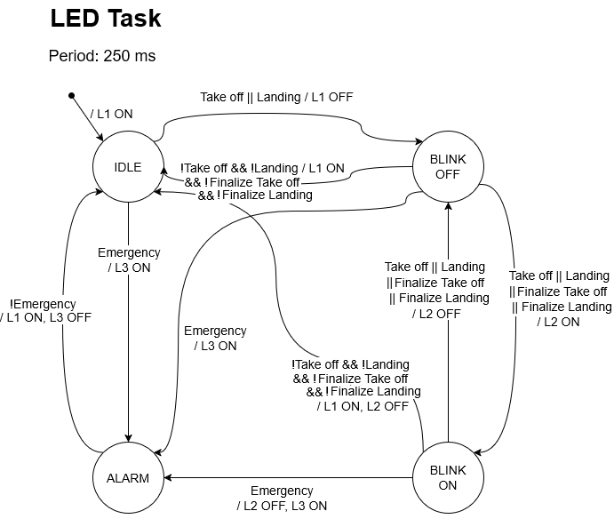

# Smart Drone Hangar

Built for the Embedded Systems and IoT course at the University of Bologna (a.y. 2025/2026).
Full specification: [assignment-02.md](https://github.com/pslab-unibo/esiot-2025-2026/blob/master/assignments/assignment-02.md).

An embedded control system for an automated drone hangar: an **Arduino Uno** manages the gate, sensors and alarms using a **cooperative, task-based scheduler** with **synchronous finite state machines**, while a **Java desktop application** acts as the remote unit that commands take-off/landing over a serial link and visualizes the hangar status in real time.

## Overview

The hangar starts closed with the drone resting inside. On a take-off/landing command received over serial, the gate opens and the system tracks the drone with a PIR sensor (presence) and an ultrasonic sonar (distance), closing the gate automatically once the drone has cleared or landed. While the drone is inside, a temperature monitor watches for overheating triggering a pre-alarm when high temperature occurs (new operations are suspended), and forcing an emergency stop when critical temperature is met (gate closed, alarm LED, operator reset required).



**Hardware:** Arduino Uno, PIR motion sensor, HC-SR04 ultrasonic sonar, servo-controlled gate, I2C LCD, analog temperature sensor (LM35/TMP36), 3 status LEDs, tactile reset button.

**Software stack:** C++ (Arduino/Wiring), PlatformIO, Java/Swing, serial communication (UART)


## Architecture

The firmware runs on a cooperative scheduler (50 ms base tick) executing four independent, periodic tasks. Each task is implemented as a **synchronous finite state machine**, and tasks communicate indirectly through a shared `Context` object, following a **Blackboard/Mediator-style design** that keeps each FSM simple.

| Task | Period | Responsibility |
|---|---|---|
| `HangarTask` | 50 ms | Core hangar/drone behavior, serial protocol with the remote unit, LCD updates |
| `GateTask` | 50 ms | Drives the servo gate |
| `TempMonitorTask` | 250 ms | Temperature sampling, alarms detection |
| `LedTask` | 250 ms | Status LEDs management |

Time- and condition-bounded requirements (e.g. "distance below D2 for more than T2 seconds") are modeled as dedicated intermediate states rather than embedded in guard conditions, keeping each transition simple to follow and implement:

<details>
<summary>FSM diagrams</summary>






</details>

## Drone Remote Unit (DRU)

A Java desktop application that acts as the drone, connecting to the Arduino over serial. It lets the operator trigger `TAKE_OFF` / `LANDING` commands and displays, live, the drone state, hangar state (normal/alarm) and current distance to the ground.

## Repository structure

```
drone-hangar/        Arduino software (PlatformIO, C++/Wiring)
  src/kernel/         scheduler, serial messaging service, logger
  src/model/          shared Context (blackboard) and hardware platform
  src/tasks/          the four task FSMs
  src/devices/        sensor/actuator drivers
drone-remote-unit/    Java desktop GUI
resources/            circuit schematic and FSM diagrams
```

## Building & running

**Firmware**: requires [PlatformIO](https://platformio.org/):
```
cd drone-hangar
pio run -t upload
```

**Remote unit**: standard Java project (`drone-remote-unit/lib/jssc-2.9.4.jar` on the classpath), importable as-is into Eclipse or built with `javac`. Launch `DashboardLauncher` and pass the Arduino's serial port.
